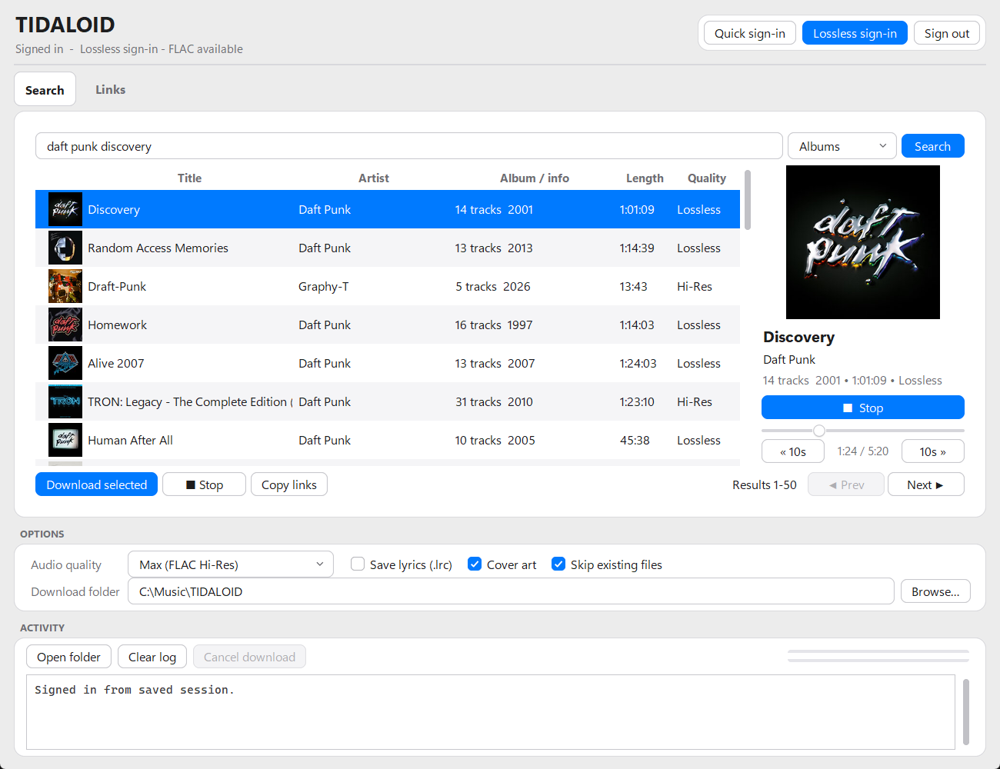

# TIDALOID

A modern GUI successor to [yaronzz/Tidal-Media-Downloader](https://github.com/yaronzz/Tidal-Media-Downloader) (tidal-dl), whose own client keys TIDAL no longer accepts.

A Windows desktop app for searching TIDAL, previewing tracks, and saving music from your own TIDAL subscription. It uses [tidalapi](https://github.com/tamland/python-tidal) and Python's built-in Tk toolkit, with a light macOS-style interface.



## Features

- **Search** tracks, albums, artists, playlists, and videos, with cover thumbnails and a large cover preview.
- **Preview** a track before you download it. Use the seek slider, ±10 s buttons, Space to play or stop, and ←/→ to skip.
- **Download** tracks, whole albums, playlists, mixes, artists, and music videos, by search or by pasting TIDAL links.
- **Quality**: AAC 96/320 kbps, FLAC 16-bit, or FLAC Hi-Res (FLAC needs a TIDAL plan that includes lossless).
- **Fast**: segments and tracks download in parallel.
- **Tagging**: title, artist, album, track and disc numbers, year, embedded cover art, a `cover.jpg` per album, and optional `.lrc` lyrics.
- **Skip existing files**, and cancel at any time.

## Requirements

- Windows 10 or 11
- Python 3.10+ (developed with 3.12)
- A TIDAL account with an active subscription
- [FFmpeg](https://ffmpeg.org/), used for previews (`ffplay`), FLAC remuxing, and videos:

  ```
  winget install Gyan.FFmpeg
  ```

  TIDALOID finds the winget install automatically, so FFmpeg doesn't need to be on `PATH`.

## Download

Grab `TIDALOID-vX.Y.Z-windows-x64.exe` from [Releases](../../releases/latest). It's a single file with nothing to install. Install FFmpeg too (see below).

The exe isn't code-signed, so Windows SmartScreen may warn the first time you run it. Click **More info → Run anyway**.

## Run from source

```
git clone https://github.com/lezet/TIDALOID.git
cd TIDALOID
python -m venv .venv
.venv\Scripts\pip install -r requirements.txt
.venv\Scripts\pythonw tidaloid.pyw
```

To get a Desktop shortcut, point one at `.venv\Scripts\pythonw.exe` with `tidaloid.pyw` as the argument. If you put your own `tidaloid.ico` next to the script or exe, it replaces the built-in window and taskbar icon.

## Building the exe

```
powershell -ExecutionPolicy Bypass -File build.ps1
```

This creates `.venv-build`, installs PyInstaller, and writes `dist\TIDALOID.exe` (about 21 MB, no console window).

**Releases are automated.** Pushing a version tag makes the [Release workflow](.github/workflows/release.yml) build the exe on GitHub and publish it as a release:

```
git tag v1.0.0
git push origin v1.0.0
```

Keep `__version__` in `tidaloid.pyw` in step with the tag. You can regenerate the app icon with `python tools/make_icon.py`.

## Signing in

| Button | How it works | Max quality |
|---|---|---|
| **Quick sign-in** | Approve a device link in your browser | AAC 320 kbps |
| **Lossless sign-in** | Sign in on TIDAL's website. The browser then shows an "Oops" page; paste that page's full address back into TIDALOID. | FLAC / Hi-Res |

The session is saved, so you only sign in once.

## Files

| Path | Contents |
|---|---|
| `~/.tidaloid.json` | settings (quality, download folder, options) |
| `~/.tidaloid-session.json` | saved TIDAL sign-in. Keep it private. |
| `~/Music/TIDALOID` | default download folder: `Artist/Album/NN - Title.flac` |

## Notes

- TIDALOID doesn't bypass DRM. Tracks that TIDAL delivers encrypted are skipped.
- Previews play through the Windows default output device using WinMM. That avoids a problem where SDL's default WASAPI output plays silently on some pro-audio interfaces.

## Credits

TIDALOID builds on these projects:

- **[Tidal-Media-Downloader](https://github.com/yaronzz/Tidal-Media-Downloader)** by yaronzz (Apache-2.0) is the project TIDALOID grew out of. It started as a Windows GUI for tidal-dl and kept tidal-dl's ideas: link-based downloads of tracks, albums, playlists, mixes, artists, and videos, the quality presets, the `Artist/Album/NN - Title` folder layout, and covers and lyrics alongside the music. TIDAL now rejects the API keys tidal-dl relies on, so TIDALOID talks to TIDAL through tidalapi instead. It contains no tidal-dl code.
- **[tidalapi](https://github.com/tamland/python-tidal)** (LGPL-3.0) handles sign-in, search, and streams.
- **[mutagen](https://github.com/quodlibet/mutagen)** (GPL-2.0+) writes the tags, **[Pillow](https://python-pillow.org/)** (MIT-CMU) handles cover art and the UI graphics, and **[requests](https://requests.readthedocs.io/)** (Apache-2.0) handles HTTP.
- **[FFmpeg](https://ffmpeg.org/)** is used for preview playback and remuxing.

## License

TIDALOID is released under the [MIT License](LICENSE). The libraries above keep their own licenses: they're installed separately with pip and aren't bundled here.

## Disclaimer

TIDALOID is an unofficial project. It isn't affiliated with, endorsed by, or connected to TIDAL. Use it only with your own subscription, for personal offline listening, and in line with TIDAL's Terms of Service and the copyright law where you live.
